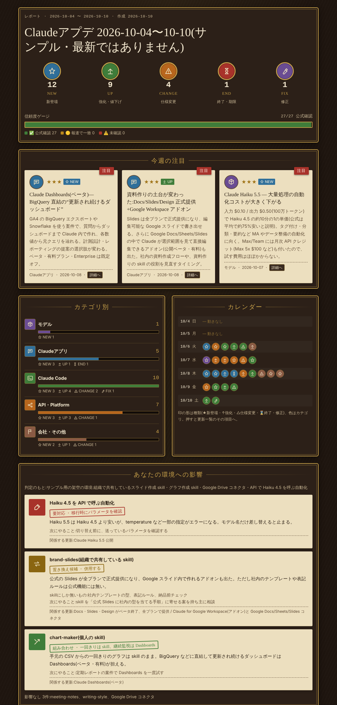
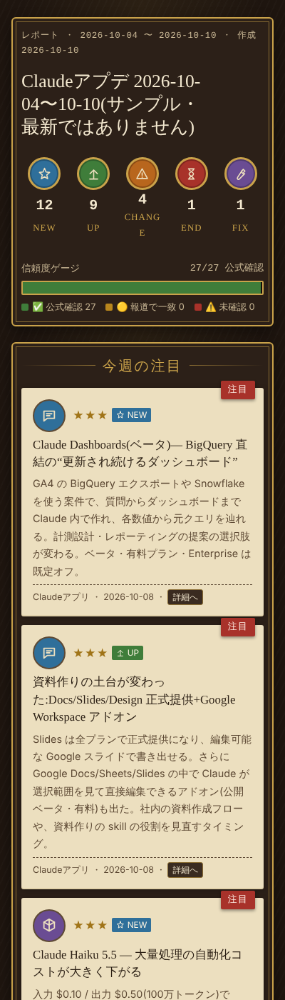

# ai-updates-digest

Claude / Anthropic のアップデートを公式の情報源から集めて、1件ずつ裏を取り、**ぱっと見で分かる1枚のレポート**にまとめる Claude 用の skill です。

「Claudeアプデ」と打つだけで、直近7日の更新が下のようなレポートになります。



[サンプルのレポート(HTML)](examples/sample-report.html) も入っています。ダウンロードしてブラウザで開くと、実際の動きを確かめられます。サンプルは 2026年10月4日〜10日の更新を例として作ったもので、最新の情報ではありません。内容の正確さは保証しないので、引用するときは出典の公式ページを確かめてください。「環境への影響」の欄は架空の環境です。

## できること

- **漏れなく集める**:Claude Resources の記事一覧、Help Center と Claude Platform の Release notes、Anthropic News、Claude Code の CHANGELOG、公式 X、報道を順に回ります。1か所だけを見て「無い」と判断しません。
- **1件ずつ裏を取る**:公式ページを開いて本文を確かめたものだけを ✅ にします。報道2本以上が一致したものは 🟡、それ以外は ⚠️ です。数字(価格・クレジット額など)は開いたページにあったものしか載せません。
- **Claude Code の日付を正確に出す**:CHANGELOG には日付が無いので、npm の公開日時と突き合わせて期間内のバージョンを出します。
- **他の AI のまとめを検証する**:Grok などのまとめを貼ると、主張ごとに「正しい / 一部違う / 誤り / 未確認」を判定し、元のまとめが落とした更新も挙げます。
- **自分の環境への影響を出す**:使っている skill やコネクタと照らして、「置き換え候補 / 組み合わせ / 要対応」を判定します。置き換えるかどうかの判断と理由も付けます。

## 使い方

| 打つ文 | 動き |
|---|---|
| `Claudeアプデ` | 今日を含む直近7日をまとめる |
| `Claudeアプデ 30日` | 直近30日をまとめる |
| `Claudeアプデ 9月` | 9月1日〜30日をまとめる |
| `Claudeアプデ 10/1〜10/10` | 指定した範囲をまとめる |
| `Claudeアプデ検証` + まとめを貼る | 貼ったまとめを1件ずつ裏取りする |

定型文を使わずに「今週の Claude のアプデまとめて」「これ合ってる?裏取りして」のように頼んでも動きます。

## 設定の診断(v0.3.0 で追加)

同じプラグインに、今の Claude の設定を診断する skill「ai-setup-checkup」も入っています。

Instructions for Claude、プロジェクトの指示、skill、コネクタ、CLAUDE.md などを、公式のベストプラクティスと照らして 🟢 良い / 🟡 改善の余地 / 🔴 要対応 で判定します。判定には、該当する行の引用と、どの基準に当たるか(出典つき)が付きます。改善案は、そのまま貼れる文面で出します。反映するのは、承認したものだけです。

| 打つ文 | 動き |
|---|---|
| `Claude診断` | 見えている設定すべてを診断する |
| `Claude診断 skill` | skill だけを診断する |
| `Claude診断 CLAUDE.md` | CLAUDE.md と `.claude/` の中だけを診断する |
| `Claude診断 指示` | Instructions for Claude とプロジェクトの指示だけを診断する |

診断の基準は `skills/ai-setup-checkup/references/best-practices.md` にまとめています(公式ドキュメントの要点と出典)。

## 入れ方

### おすすめ:プラグインとして入れる(自動で最新版になる)

1. Claude の **カスタマイズ > プラグイン**(Customize > Plugins)を開く。
2. 右上の **「+ 追加」の ▼** から **「マーケットプレイスを追加」**(Add marketplace)を選ぶ。
3. URL に `Kozue-front/ai-updates-digest` と入力し、**「自動的に同期」**(Sync automatically)をオンのまま **「同期」** を押す。
   - GitHub の確認画面(Install Claude)が出た場合は、画面に従って進めてください。リポジトリを選ぶ画面では「Only select repositories」(選んだものだけ)で必要なものだけを選ぶのがおすすめです。
4. **「探索」** タブに出る **AI Updates Digest** の **「+」** を押してインストールする。
5. 新しいチャットで「Claudeアプデ」と打って動けば完了です。

更新はふつう自動で届きます。すぐ届かないときは、**「+ 追加」の ▼ →「マーケットプレイスを管理」** → ai-updates-digest の **「⋮」→「アップデートを確認」** を押してください。プラグインの詳細画面に出る版の番号が新しくなれば反映済みです。

Claude Code の場合は、次の1行で入ります。

```
/plugin install ai-updates-digest --marketplace Kozue-front/ai-updates-digest
```

すでに `.skill` を手でアップロードしている場合は、同じ skill が2つにならないよう、**カスタマイズ > Skills** からそちらを削除してください。

### `.skill` ファイルで入れる(Claude.ai / デスクトップアプリ / Cowork)

1. [Releases](../../releases) から `ai-updates-digest.skill` をダウンロードします。設定の診断も使うなら、`ai-setup-checkup.skill` もダウンロードします。
2. Claude の **Customize > Skills** で、ダウンロードしたファイルを1つずつアップロードします。

この方法で入れた skill は、自動では更新されません。新しい版が出たら、古いものを削除してから入れ直してください。
3. Team / Enterprise プランなら、skill の画面から組織に共有できます(組織の設定で共有が許可されている場合)。

`.skill` ファイルは zip 形式です。自分で作る場合は、`skills/ai-updates-digest` フォルダを、フォルダごと zip にしてください。

### フォルダをコピーして入れる(Claude Code)

`skills/ai-updates-digest` フォルダ(診断も使うなら `skills/ai-setup-checkup` も)を、次のどちらかにコピーします。

```bash
# 自分の全プロジェクトで使う
cp -r skills/ai-updates-digest ~/.claude/skills/

# このプロジェクトだけで使う
cp -r skills/ai-updates-digest .claude/skills/
```

## 必要なもの

- **Web 検索とページ取得**:情報源を回るのに使います。
- **コード実行(あると良い)**:同梱のスクリプトで、Claude Code の更新の抽出とレポートの組み立てをします。使えない環境では、skill の手順に書いた手作業の方法に切り替わります。
- **ネットワーク**:スクリプトは `registry.npmjs.org` と `raw.githubusercontent.com` にアクセスします。

## 中身

```
.claude-plugin/
├── plugin.json                  プラグインの名前・バージョン・説明
└── marketplace.json             このリポジトリにあるプラグインの一覧
skills/ai-updates-digest/
├── SKILL.md                     手順(情報源の回り方、確度の付け方、出力)
├── references/
│   ├── sources.md               情報源の一覧と読み方、過去の見落としの例
│   ├── impact.md                環境への影響の判定基準
│   └── data-format.md           レポートのデータ形式
├── scripts/
│   ├── claude_code_releases.py  npm の公開日時で期間内の Claude Code の更新を出す
│   └── build_report.py          データを HTML レポートにする(形式チェック付き)
└── assets/
    └── report_template.html     レポートのテンプレート(外部ライブラリなし)
skills/ai-setup-checkup/
├── SKILL.md                     設定の診断の手順(棚卸し、判定、レポート、反映)
└── references/
    └── best-practices.md        診断の基準(公式のベストプラクティスと出典)
```

レポートのデザインはテンプレートに固定されているので、誰が作っても同じ見た目になります。スマホでも読めます。JavaScript のライブラリは使っていません。フォントだけ Google Fonts から読み込みます(いずれも SIL Open Font License)。読み込めない環境では、端末のフォントで表示されます。



## 注意

- これは個人が作った非公式の skill です。Anthropic による提供・承認・保証は受けていません。公開されている公式情報を自動で集めて裏を取るためのツールです。Claude、Anthropic は Anthropic, PBC の商標です。
- 情報源のページ構成が変わると、集め方の調整が必要になることがあります。気づいたら Issue で教えてください。
- 「環境への影響」は、レポートを作った人の会話で見えている skill やコネクタをもとに判定します。レポートを他の人に共有するときは、その点を添えてください(レポート上にも「判定のもと」として書かれます)。

## ライセンス

[MIT](LICENSE)

---

## English summary

**ai-updates-digest** is a Claude skill that collects Claude / Anthropic updates from official sources, verifies each item, and renders a single at-a-glance HTML report (Japanese UI).

- Type `Claudeアプデ` (optionally followed by a period such as `30日`) to get a digest of the last 7 days.
- Type `Claudeアプデ検証` and paste a summary from another AI to fact-check it claim by claim.
- Each item is tagged ✅ official / 🟡 two independent press reports / ⚠️ unverified. Claude Code release dates come from npm publish times.
- The report also flags how the updates affect the skills and connectors you use (replace / combine / action needed).
- Since v0.3.0, the plugin also includes **ai-setup-checkup**: type `Claude診断` to audit your instructions, projects, skills, connectors and CLAUDE.md against Anthropic's published best practices, with quoted evidence, ready-to-paste fixes, and changes applied only after you approve them.

Install (recommended): in Claude, open Customize > Plugins, choose "+ Add" ▾ > "Add marketplace", enter `Kozue-front/ai-updates-digest`, keep "Sync automatically" on and click "Sync" (approve the GitHub "Install Claude" screen if it appears), then install AI Updates Digest from the Explore tab. If an update does not arrive, use "+ Add" ▾ > "Manage marketplaces" > ⋮ > "Check for updates". In Claude Code: `/plugin install ai-updates-digest --marketplace Kozue-front/ai-updates-digest`. You can also upload `ai-updates-digest.skill` (and `ai-setup-checkup.skill`) from Releases — these do not update automatically — or copy `skills/ai-updates-digest` into `~/.claude/skills/`.

Unofficial; not provided, endorsed, or warranted by Anthropic. Claude and Anthropic are trademarks of Anthropic, PBC. The sample report reflects updates from Oct 4–10, 2026 and is not kept current. Fonts are loaded from Google Fonts (SIL OFL). MIT licensed.
